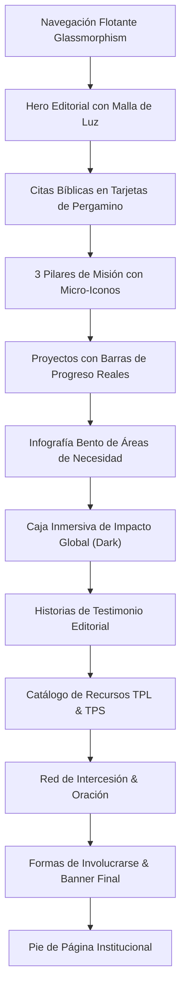

# Rediseño de la Página de Inicio: Idiomas Puentes

Este documento detalla el rediseño completo de la página principal (**Inicio**) de [idiomaspuentes.org](https://idiomaspuentes.org). 

El objetivo principal alcanzado es elevar la calidad estética, legibilidad y jerarquía visual del sitio a un estándar internacional contemporáneo (al estilo de organizaciones globales como *BibleProject*, *Wycliffe* o *Seed Company*), **sin alterar ninguna palabra o dato informativo** y **respetando rigurosamente su paleta cromática original**.

---

## 🎨 1. Paleta de Colores Oficial Preservada

Se mantuvieron exactamente los códigos y valores cromáticos identitarios del sitio original:

| Rol de Color | Código Hex / Token | Aplicación en el Rediseño |
| :--- | :--- | :--- |
| **Azul Marino Profundo (Hero & Impacto)** | `#0A1628` | Fondo inmersivo del Hero, gradientes nocturnos y caja de Impacto Global. |
| **Azul Marino Secundario (Superficies)** | `#13233D` | Tarjetas de métricas oscuras con bordes de cristal suave (`border-white/10`). |
| **Azul Marino Títulos & Textos** | `#172554` / `#0A1628` | Tipografía de encabezados H1, H2, H3 principales (`text-blue-950`). |
| **Azul de Acción / Botones** | `#1E3A8A` / `#1E40AF` | Botón activo de navegación, botón de impacto y badges de proyectos completados. |
| **Terracota / Óxido (Acento Principal)** | `#B35438` | Llamados a la acción (CTA) primarios ("Donar", "Involúcrate", "Conoce más"). |
| **Terracota Hover & Presionado** | `#96432B` / `#8B4513` | Estados interactivos hover y focus de botones terracota. |
| **Terracota Acento & Luces** | `#D97757` | Resaltados de texto en fondos oscuros y números destacados en métricas. |
| **Arena Cálida (Biblia & Fondos)** | `#FAF7F2` | Sección bíblica, micro-fondos de iconos y tarjetas de escrituras. |
| **Marfil Suave (Secciones Claras)** | `#FCFBF9` | Fondo de Misión, Áreas de Necesidad y Red de Intercesión. |
| **Hueso / Gris Cálido (Alternancia)** | `#F7F5F0` | Fondo de Proyectos, Recursos Disponibles y Formas de Involucrarse. |
| **Blanco Nieve (Superficies)** | `#FFFFFF` | Tarjetas de contenido con elevación sutil y bordes orgánicos. |
| **Gris Texto & Cuerpo** | `#374151` / `#4B5563` | Lectura cómoda, alto contraste accesible (cumple WCAG AAA). |

---

## 📐 2. Principales Mejoras de Arquitectura & UI/UX

### Detalle de Transformación por Sección:

1. **Navegación Flotante (`glass-nav`)**:
   - Pasa de una barra gris rígida a una barra flotante con efecto de cristal esmerilado (*backdrop-filter blur*), esquinas redondeadas modernas y botón "Donar" con ícono de ayuda.
   - Menú móvil responsivo y accesible integrado sin recargar la página.

2. **Hero Editorial Inmersivo**:
   - Fondo con degradado radial sutil (*radial mesh*) en azul marino `#0A1628` con destellos terracota y azul zafiro.
   - Tag flotante superior *"Misión & Traducción Bíblica"*.
   - Imagen principal montada en un marco de cristal con sombra profunda y ficha informativa flotante.
   - Mantiene la cita completa y botones: *"Nuestros Proyectos"* e *"Involúcrate"*.

3. **Fundamento Bíblico ("Siguiendo el Ejemplo de la Iglesia Primitiva")**:
   - Tarjetas simétricas de alta legibilidad con comillas estilizadas en gran formato.
   - Línea acento lateral en Azul Marino para **2 Corintios 8:1-2** y Terracota para **Hechos 11:29**.

4. **Nuestra Misión**:
   - Encabezado con etiqueta en mayúsculas y bandera distintiva.
   - 3 tarjetas con íconos vectoriales en contenedores cálidos (`#FAF7F2`) y etiquetas de compromiso al pie.

5. **Nuestros Proyectos**:
   - Barras de progreso visuales calibradas al 9% (*Traducción al idioma puente español*) y al 100% (*Historias Bíblicas Abiertas en español*).
   - Bloques métricos internos con fondo crema que destacan la meta (66 libros) y el alcance (Hispanoamérica).

6. **Áreas de Necesidad**:
   - Cuadrícula estilo *Bento Grid* de 4 columnas.
   - Números de gran impacto visual (`92,5%`, `60%`, `76,9%`, `119`) con enlaces directos a las fuentes documentales (*Instituto Cervantes*, *SISPPI CELADE*, *IWGIA*, *Ethnologue*).

7. **Nuestro Impacto Global**:
   - Caja inmersiva nocturna `#0A1628` con destellos de iluminación ambiental.
   - 4 cuadrículas de métricas destacadas en tono `#D97757` con subtítulos descriptivos claros.

8. **Historias de Impacto**:
   - Tarjetas de testimonio tipo revista para Armando, Omar y Ester con badges geográficos (`AMAZONÍA`, `SUDAMÉRICA`).
   - Módulo destacado inferior *"Comparte tu historia"* con llamado al contacto directo.

9. **Recursos Disponibles**:
   - Tarjetas con explicación clara del Texto Puente Literal (TPL) y Texto Puente Simple (TPS), ayudas exegéticas y discipulado.

10. **Red de Intercesión & Formas de Involucrarse**:
    - División clara de motivos de oración (Traductores, Comunidades, Recursos).
    - Canales de participación: Orando, Donando y Sirviendo.
    - Banner de cierre en gradiente con doble botón de acción ("Contáctanos" e "Involúcrate").

---

## 📁 3. Archivo del Proyecto Generado

El código fuente completo, listo para abrir en cualquier navegador o desplegar en producción, se encuentra en:

- [index.html](file:///C:/Users/elish/.gemini/antigravity/scratch/idiomaspuentes-redesign/index.html)

### ¿Cómo probarlo localmente?
1. Puedes abrir directamente el archivo [index.html](file:///C:/Users/elish/.gemini/antigravity/scratch/idiomaspuentes-redesign/index.html) en tu navegador web (Google Chrome, Edge, Firefox, Safari).
2. Es completamente autónomo: carga fuentes tipográficas elegantes (*Lora* y *Plus Jakarta Sans*), Tailwind CSS y la librería de íconos *Lucide*.
